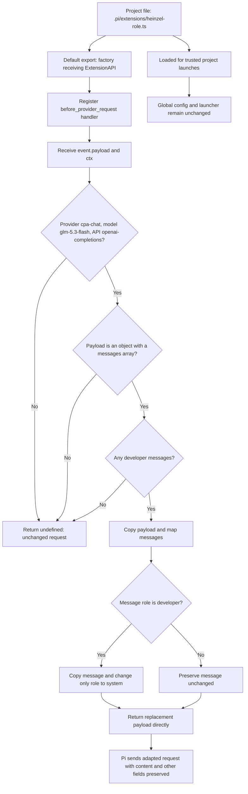

# Project-scoped system-prompt role compatibility

## Goal

Make the heinzel prompt work reliably in this repository while leaving Pi's global configuration, launcher, and behavior in other repositories unchanged.

Implement a project extension at `.pi/extensions/heinzel-role.ts`. Keep the existing `.pi/SYSTEM.md` as the source of the heinzel instructions. This document is a plan; the extension has not been implemented.

## Verified findings

- The inspected session `01a0ff14-e195-7359-89fd-41d5acac52e4` records the updated heinzel identity instruction in its system-prompt preamble.
- A diagnostic replay through the installed OpenAI-completions adapter encoded those instructions as a `developer` message for `cpa-chat / glm-5.3-flash`.
- A live A/B test using the same recorded context produced a generic coding-agent introduction with `developer`, and a heinzel introduction with `system`. Only the instruction-message role changed between requests.
- This establishes a role-handling difference on the provider/model path. It does not establish whether the gateway or the upstream model is responsible, nor guarantee compliance on every future response.
- The installed Pi version supports project extensions and the `before_provider_request` event. That event can return a replacement outgoing payload.

There is no hostname condition for identity. The earlier explanation that the heinzel persona must be activated by a hostname was incorrect.

## Configuration boundaries

| Resource | Scope and purpose |
| --- | --- |
| `.pi/SYSTEM.md` | Trusted project prompt replacement. |
| `.pi/settings.json` | Supported project settings, but not the model compatibility flag discussed here. |
| `~/.pi/agent/models.json` | User-level model configuration. Setting `compat.supportsDeveloperRole: false` here affects that model across projects. |
| `.pi/models.json` | Not automatically discovered by the inspected Pi version. |
| `.pi/extensions/heinzel-role.ts` | Proposed project-only outgoing-request adaptation; requires project trust. |

The default prompt builder generates its prose `tools`, `rules`, and `docs` sections only when no custom prompt is supplied. A custom `SYSTEM.md` skips those default sections; tool API declarations are independent. This extension will not restore or change those sections.

## Ownership and contract

**Owner:** `.pi/extensions/heinzel-role.ts`, responsible only for this repository's outgoing instruction-role compatibility.

**Dependencies:** Pi's `ExtensionAPI` and `before_provider_request` event. No new external dependency, provider registration, credential handling, or custom launcher is needed.

**Input:** the handler receives `event.payload` of type `unknown` and the extension context `ctx`.

**Output:** return a replacement payload directly, not `{ payload: replacement }`. Return `undefined` when the request is outside the supported scope or has an unsupported shape.

**Scope guards:**

- Selected provider: `ctx.model.provider === "cpa-chat"`.
- Selected model: `ctx.model.id === "glm-5.3-flash"`.
- Selected API: `ctx.model.api === "openai-completions"`.
- Payload: non-null object with a `messages` array.

This design targets the currently verified direct model selection. Virtual-model routing or extensions that change the actual request model need separate validation; do not assume `ctx.model` always identifies the physical model in those configurations.

**Transformation:** copy the payload; map its messages; copy each message whose `role` is `developer` with its role changed to `system`. Preserve content and every other message field. Leave nonmatching messages unchanged. Do not mutate the original payload.

**Preserved behavior:** model selection, tools, request parameters, prompt content, user messages, assistant messages, tool results, and other payload fields.

**No matching messages:** return `undefined` rather than creating an unnecessary replacement.

**Secrets:** do not log payloads, headers, credentials, or complete prompts. Tests and diagnostics should expose only role summaries and synthetic content.

## Implementation plan

1. **Confirm the installed extension contract.** Check the installed `docs/extensions.md`, `dist/core/extensions/types.d.ts`, and the provider-request hook wiring. Confirm project discovery, direct replacement return semantics, and the context's model fields before coding.
2. **Implement the narrowly scoped extension.** Export a factory receiving `ExtensionAPI`; register `before_provider_request`; apply the guards and immutable role transformation above. Keep transformation logic locally testable without starting Pi. Do not edit the global model configuration or launcher.
3. **Test the transformation with synthetic payloads.** Cover the target model, other providers/models/APIs, unsupported payload shapes, no developer messages, mixed roles, field preservation, and input immutability. Include repeated application to verify the transformation is idempotent.
4. **Verify a fresh Pi session in this repository.** Grant project trust if needed. Verify at the outgoing-payload boundary that the target request contains the unchanged heinzel instructions under `system` rather than `developer`; then ask `who are you?`. A session preamble record alone is not proof of the outgoing API role. Check tool declarations and perform an explicitly requested read-only task to verify the extension did not remove tool access.
5. **Verify isolation and record results.** Confirm another provider/model in this repository is unchanged, and a fresh Pi session outside this repository retains its prior behavior. Record the installed Pi version, checks performed, and any gaps. To roll back, remove or disable only this project extension and start a fresh session; no global configuration should need restoration.

## Extension schema

## Acceptance criteria

- The targeted outgoing request carries heinzel instructions under `system`, with their content unchanged.
- Synthetic tests demonstrate that the transformation changes only matching message roles and does not mutate inputs.
- The target identity check succeeds in a fresh session; failures are reported as observations, not attributed to prompt loading without evidence.
- Other models/providers and launches outside the repository remain unchanged.
- No credentials, full payloads, or complete prompts appear in test output or documentation.
